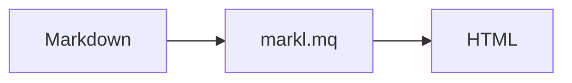

# Build a multi-page HTML site

This page walks through a small static site, such as a blog or a documentation site, built from a directory of Markdown files. Every command was run as shown. Paths are relative to the `markl.mq` directory; if your site lives elsewhere, point the `-L` options at it.

You need mq v0.10.0 or later (`marl_build_site` creates the output directories with `mkdir`) and the submodules from [Getting started](getting-started.md).

## 1. Lay out the project

```text
mysite/
  content/        one Markdown file per page (front matter on top)
    index.md
    hello.md
    about.md
  themes/site/    layout.md, html.md and components such as callout.md
  assets/         files copied as they are (CSS, images)
  build.mq        the build query
  build.sh        runs it
```

`marl_build_site` reads every `.md` file under `content/` and every `.md` file under `themes/`. A page is rendered as a template, then wrapped in the layout, then converted to HTML and wrapped in the HTML shell. See [Articles and site builds](articles.md) for how each step works.

## 2. Write the pages

Each page starts with YAML front matter, which is available as `page` in templates.

`mysite/content/hello.md`:

````markdown
---
title: Hello
date: 2026-10-25
---

## Welcome

This page is rendered as `{{ page[:title] }}`.


Components work in pages too.


## A diagram


````

`mysite/content/about.md` is the same idea. Setting `toc: true` in its front matter makes the layout below print a table of contents.

```markdown
---
title: About
date: 2026-10-20
toc: true
---

## Who

Someone.

## Why

Because.
```

Fenced code blocks and inline code are not evaluated as templates in pages, so the `{{ page[:title] }}` inside backticks above is printed as it is.

## 3. Write the theme

A theme is a directory under `themes/` whose name you pass as the `theme` option. It usually holds three templates.

`mysite/themes/site/layout.md` turns the page body into the Markdown of the whole page. `content` is the rendered body.

```text
# {{ page[:title] }}

*{{ page[:date] | date("%B %d, %Y") }}*

{{ content | toc(2, 2) }}

{{ content }}
```

`mysite/themes/site/html.md` is the HTML shell used with `html: true`. `content` is now the converted HTML body.

```text
<!doctype html>
<html lang="en">
<head>
<meta charset="utf-8">
<meta name="viewport" content="width=device-width, initial-scale=1">
<title>{{ page[:title] }}</title>
<link rel="stylesheet" href="style.css">
</head>
<body>
<nav><a href="index.html">Home</a></nav>
<main>
{{ content }}
</main>
</body>
</html>
```

`mysite/themes/site/callout.md` is a component. `html` is true during an HTML build, so a component can emit HTML there and platform syntax otherwise (see [Layouts, components, and themes](layouts-and-themes.md)).

```text

<div class="callout"><strong>{{ type | default("note") }}</strong>

{{ body | trim }}

</div>

> [!{{ type | default("note") | upper }}]
> {{ body | trim | replace("\n", "\n> ") }}

```

If your CSS contains `{{` or `{%`, wrap the stylesheet in `...`. Keeping the CSS in a separate file, as here, avoids that.

## 4. Write an index page

Every template can read `pages`: the front matter of all pages, newest `date` first, with `name` and `slug` added. That is enough for an index.

`mysite/content/index.md`:

```markdown
---
title: My site
layout: false
---

# My site



- {{ post[:title] | link(post[:slug] + ".html") }} ({{ post[:date] | date("%B %d, %Y") }})

```

`layout: false` skips the layout for this page, so the heading comes from the body. `-%}` strips the newline after the tag, which keeps the list tight (without it each item becomes a paragraph).

## 5. Build

`marl_build_site(content_dir, themes_dir, out_dir, data, options)` builds every page and writes the result:

```sh
mq -I null -R -W -L . -L vendor/mqmq -L vendor/mermaid.mq \
  'include "marl" | marl_build_site("mysite/content", "mysite/themes", "mysite/public", {}, {theme: "site", html: true, mermaid: true})'
```

```text
["mysite/public/hello.html", "mysite/public/about.html", "mysite/public/index.html"]
```

- `html: true` converts each page to HTML, wraps it in the theme's `html` partial, and names the files `.html` instead of `.md`.
- `mermaid: true` draws the ```` ```mermaid ```` blocks as inline SVG (`mermaid_theme: "dark"` or `"auto"` picks the diagram colors).
- Every heading gets an `id` that matches the links `toc` writes. Pass `heading_ids: false` to turn that off.
- Directories under `out_dir` are created as needed.
- If any page fails, nothing is written and one error lists every failing page, for example `bad.md: bad.md:1:1: Undefined variable 'nope'`.

`-R` and `-W` allow reading the sources and writing the output, since file access is off by default. You can narrow them, as in `-W=mysite/public`, but the directory you name must already exist.

## 6. Keep the command in a script

Put the query in a file and the command in a script, so that you can run it with one word.

`mysite/build.mq`:

```text
include "marl"
| marl_build_site("mysite/content", "mysite/themes", "mysite/public", {},
    {theme: "site", html: true, mermaid: true})
```

`mysite/build.sh`:

```sh
#!/bin/sh
set -eu
cd "$(dirname "$0")/.."
mq -I null -R -W -L . -L vendor/mqmq -L vendor/mermaid.mq -f mysite/build.mq
cp mysite/assets/* mysite/public/
```

Keep `-I null` in a script. mq only assumes it when no file is given and stdin is a terminal, so without the flag a script run from CI, a pipe, or an editor waits for input. The `cp` line copies static files, which markl does not touch.

Open `mysite/public/index.html` to look at the result. The links are relative, so it also works from a local server:

```sh
python3 -m http.server 8000 --directory mysite/public
```

## 7. Add a second language

Put each language in its own directory and mark the pages with a `lang` field. The directory becomes part of the output path (`content/ja/hello.md` is written to `public/ja/hello.html`), and `slug` includes it (`ja/hello`).

```text
content/
  en/index.md  en/hello.md
  ja/index.md  ja/hello.md
```

An index lists only the pages of its own language. `order: 0` marks the index so that the filter can skip it, and the link keeps only the last part of the slug because the index lives in the same directory:

```markdown
---
title: Home
lang: en
layout: false
order: 0
---



- {{ post[:title] | link(last(split(post[:slug], "/")) + ".html") }}

```

The HTML shell can link to the same page in the other language, assuming both languages use the same file names:

```text
<html lang="{{ page[:lang] }}">
...
<nav><a href="../{{ other }}/{{ last(split(page[:slug], "/")) }}.html">{{ other }}</a></nav>
```

Pages in each language set `lang` and a shared `order`, such as `order: 1` for `hello.md` in both directories.

## Tips

- **See every error at once.** `marl_build_site` already reports all failing pages. To handle the errors yourself, call `marl_try_build` and look at `result[:errors]`.
- **Dates.** `date` takes `YYYY-MM-DD` or RFC 3339 and a `strftime` format. `pages` is sorted by it, newest first.
- **One page, several platforms.** Build the same content with another `theme` (for example `zenn` or `devto`, see `examples/`) and without `html: true` to get Markdown for that platform.
- **Faster, portable builds.** `mq compile` can turn `build.mq` into a `.mqc` file that needs neither the submodules nor `-L` to run (see [Getting started](getting-started.md)).
